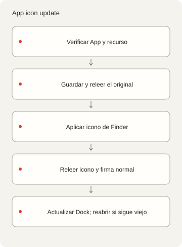
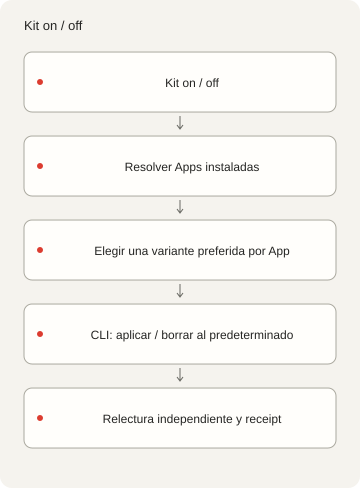

<p></p>

# X-DockIcons

[English](README.md) · [简体中文](README.zh-Hans.md) · [繁體中文](README.zh-Hant.md) ·
[日本語](README.ja.md) · [한국어](README.ko.md) · [Español](README.es.md)

Gestione iconos personalizados de Apps y Dock de macOS desde la línea de comandos. Registre, aplique
y restaure sus propios PNG; este código tools-only no incluye una colección lista para usar.

## Inicio

Los comandos de catálogo sin conexión requieren Deno 2. Inspeccionar Apps, convertir PNG a ICNS y
operar iconos requiere macOS y Xcode Command Line Tools. No necesita npm, cuenta, servicio de IA ni
servicio en segundo plano. Consulte las [dependencias](DEPENDENCIES.md).

```sh
./dock-icons help
./dock-icons list
./dock-icons check
./dock-icons prompt
```

El código tools-only empieza con `{"version":1,"icons":[]}`: `list` devuelve una lista vacía y
`check` verifica cero recursos. Sólo comprueba el inicio vacío; no prueba imágenes reales. `prompt`
sin ID devuelve texto y estilo; no genera imágenes ni llama a un proveedor de IA.

## Añadir imágenes con derechos de uso

Use un PNG RGBA cuadrado de 1024–4096px con esquinas realmente transparentes, de hasta 15 MiB. Cree
primero la carpeta de recursos. Sustituya el bundle ID, nombre y titular del ejemplo por la App y
los derechos reales. Registrar una imagen no concede derechos sobre la identidad de la App.

```sh
mkdir -p icons/nothing
./dock-icons add my-icon '/path/owned.png' \
  --bundle-id example.myapp --name 'My App' --rights-owner 'Your name'
./dock-icons check
```

`add` empaqueta y decodifica diez tamaños ICNS antes de registrar la entrada. Rechaza IDs y archivos
existentes. Conserve el original de entrada. Después, `check` verifica ambos hashes y las reglas de
forma/alfa del PNG. [style.json](styles/nothing/style.json) da una referencia de color inspirada en
Nothing; no incluye Atlas ni otras imágenes de la colección original. Generar y aplicar requieren su
propia autorización.

## Operaciones de App y recuperación

Tras registrar su recurso, use su ID y la App real prevista. El bundle ID de la App debe coincidir
con el catálogo. La ruta de salida de exportación debe ser nueva.

```sh
./dock-icons status my-icon --app '/path/My App.app'
./dock-icons apply my-icon --app '/path/My App.app'
./dock-icons restore my-icon --app '/path/My App.app'
./dock-icons default my-icon --app '/path/My App.app'
./dock-icons export my-icon '/path/new-output.png' --app '/path/My App.app'
```



`apply` valida ambos hashes y la identidad de la App, guarda y relee el icono y metadatos Finder
actuales, y después cambia el icono personalizado mediante `NSWorkspace.setIcon`. Repetir conserva
el primer respaldo y omite una imagen coincidente. `restore` vuelve a esa base capturada, incluso un
icono personalizado anterior; falla sin respaldo verificado. `default` borra al icono integrado
actual y conserva el respaldo, sin sustituir la base personalizada anterior. Informa diferencias si
una actualización cambia el icono integrado.

Un bloqueo serializa operaciones. Se guardan recibos prepared/completed/failed y una lectura de
imagen en otro proceso. Se rechazan imágenes vacías o sustitutos genéricos. Se comparan firmas deep
normales antes/después; no se cambian Contents firmados ni identidad de firma. Las Apps Apple
protegidas sólo admiten inspección/exportación. No se omite SIP/TCC, no se vuelve a firmar, no se
crean proxies, no se cierran Apps ni se reinicia Dock o cambia el tema. Directorios de root pueden
requerir un ayudante de administrador instalado aparte. El código tools-only no lo incluye y debe
configurarse con `X_DOCKICONS_ADMIN_HELPER`; no hay valor predeterminado. Su ausencia, cancelación o
fallo de limpieza son errores visibles. Consulte [dependencias](DEPENDENCIES.md).

Tras una interrupción, revise primero `operations.jsonl`, `backup.json`, ruta de App y `status`. Un
recibo sólo prepared deja resultado desconocido. No borre un bloqueo activo; confirme que su proceso
terminó antes de retirar uno obsoleto y reutilice el respaldo verificado. No se ocultan fallos ni se
afirma una reversión automática. Se conservan etiquetas Finder posteriores.

Completar demuestra `verificationScope: "stored-icon-only"`, no el Dock visible. Actualice Dock
usted; si persiste un icono antiguo, guarde su trabajo y reabra esa App. Se indican Apps en
ejecución también al repetir o estar ya en defecto. Actualizar/reinstalar puede eliminar
personalización; Clear/Tinted puede cambiar su aspecto. No hay servicio de reaplicación al inicio ni
aceptación de reinicio físico. Se probaron la aplicación y restauración en una App firmada y
aislada; no se modificaron Apps instaladas.

## Adaptador Kit opcional

```sh
./dock-icon list
./dock-icon on my-icon --plan
./dock-icon off my-icon --plan
```

El adaptador incluido `./dock-icon` necesita al menos una entrada; el inicio vacío no tiene estilo
ni destino seleccionable. `fzf` es opcional para selección en terminal. La instalación de sistema
`kit dock-icon` es externa y no se incluye. `--plan` sólo descubre destinos, sin escribir iconos.
`on` aplica una variante preferida por App instalada no protegida; `off` vuelve al integrado actual
y conserva respaldos. `restore` vuelve a la base capturada. Apps ya en defecto omiten escritura y
creación de respaldo. Varias variantes de un estilo/bundle ID necesitan exactamente un
`preferred: true`; IDs exactos eligen variantes. Las coincidencias únicas ignoran caso, espacios y
puntuación. Ambigüedad o error de descubrimiento detiene antes de escribir; fallos individuales
quedan visibles y devuelven código no cero. Es macOS-only y no cambia iconos de barra de menús.



## Configuración, derechos y comprobaciones

[catalog.json](catalog.json) guarda identidades, hashes y derechos.
`--catalog /absolute/catalog.json` selecciona otra colección con recursos relativos al archivo.
`--state-dir /absolute/path` sustituye `~/Library/Application Support/X-DockIcons`; los ayudantes se
almacenan en `.local/`. `--app` elige una ruta prevista y mantiene controles de
identidad/protección. La búsqueda automática revisa ubicaciones Applications estándar y rechaza
varias coincidencias. Mantenga respaldos, recibos y exportaciones personales fuera de la carga
pública.

Las herramientas usan una CLI Deno local y un pequeño ayudante AppKit. Los originales privados, las
vistas derivadas de ICNS, el catálogo y el historial se conservan fuera del código tools-only.

Marca documental: [codingEzio](https://github.com/codingEzio) ·
[CC BY 4.0](https://creativecommons.org/licenses/by/4.0/) · [Alcance](LICENSE-DOC-ARTWORK.md).
Código y doce diagramas genéricos: [MPL-2.0](LICENSE). La licencia de marca sólo cubre su SVG; no
concede imágenes antiguas, fuentes, marcas ni identidades ajenas. Registre derechos/procedencia de
sus entradas. Nothing/Nothing OS inspira el diseño, sin asociación ni respaldo.
[Créditos](CREDITS.md).

```sh
deno task check
deno task test
deno task public:test
deno task public:prepare
```

En macOS, `deno task test` compila el validador nativo de imágenes y requiere Xcode Command Line
Tools; las pruebas no modifican iconos de Apps.

Comprueban código, límites sintéticos de rutas/exportación y candidato local. Verificar cero
recursos no prueba empaquetado real, cambios de iconos instalados, Dock visible ni reinicio.
[Preparación de publicación](PUBLICATION.md) explica los archivos seleccionados y sus límites. Estos
comandos no publican, suben, crean remotos ni reescriben el historial privado conservado.

Las adiciones simultáneas al mismo catalog se rechazan mientras esté bloqueado. Tras una
interrupción, revisa el bloqueo y los archivos incompletos; no borres un bloqueo activo. Export no
sobrescribe archivos existentes.
