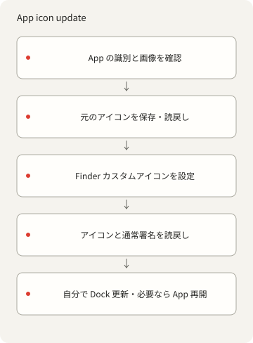
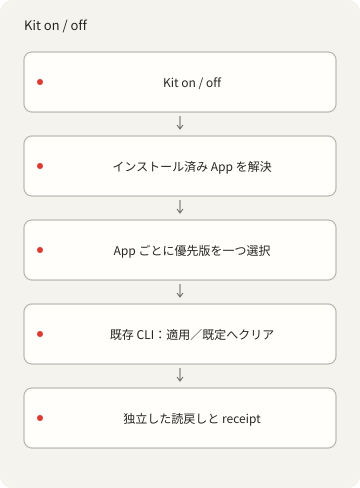

<p></p>

# X-DockIcons

[English](README.md) · [简体中文](README.zh-Hans.md) · [繁體中文](README.zh-Hant.md) ·
[日本語](README.ja.md) · [한국어](README.ko.md) · [Español](README.es.md)

コマンドラインで macOS App と Dock のカスタムアイコンを管理します。自分の PNG
を登録、適用、復元できます。この tools-only ソースに既製のアイコン集はありません。

## 開始

オフラインのカタログ操作には Deno 2、App 確認、PNG→ICNS 変換、アイコン操作には macOS と Xcode
Command Line Tools が必要です。npm、アカウント、AI サービス、常駐サービスは不要です。
[依存関係](DEPENDENCIES.md)を参照してください。

```sh
./dock-icons help
./dock-icons list
./dock-icons check
./dock-icons prompt
```

tools-only ソースの初期値は `{"version":1,"icons":[]}` です。`list` は空、`check`
の検証数はゼロです。 空の初期状態を確認するだけで、実画像の検証ではありません。ID なしの `prompt`
は文字とスタイル設定を返し、 画像生成や AI 呼び出しを行いません。

## 使用権のある画像を追加

入力は正方形 1024–4096px RGBA PNG、四隅が実際に透明、最大 15 MiB とします。先に保存先を作成します。
例の bundle ID、名前、権利者を実際の App と権利情報へ置き換えてください。登録自体は App
の権利を付与しません。

```sh
mkdir -p icons/nothing
./dock-icons add my-icon '/path/owned.png' \
  --bundle-id example.myapp --name 'My App' --rights-owner 'Your name'
./dock-icons check
```

`add` は十サイズの ICNS を作成・再デコードしてから登録します。既存
ID／ファイルは拒否します。入力原本を保持してください。 その後の `check` は両ファイルのハッシュと PNG
の形状／アルファを確認します。 [style.json](styles/nothing/style.json) は Nothing-inspired
の配色参考で、Atlas など旧画像は含みません。 画像生成と適用はそれぞれ許可が必要です。

## App 操作と復元

自分の画像を登録した後、その ID と意図した実 App を使います。App の bundle ID
は登録値と一致する必要があります。 export の出力先は未作成のパスを指定します。

```sh
./dock-icons status my-icon --app '/path/My App.app'
./dock-icons apply my-icon --app '/path/My App.app'
./dock-icons restore my-icon --app '/path/My App.app'
./dock-icons default my-icon --app '/path/My App.app'
./dock-icons export my-icon '/path/new-output.png' --app '/path/My App.app'
```



`apply` は両ハッシュと App 身元を検証し、現在のアイコンと Finder メタデータを保存・読み戻してから
`NSWorkspace.setIcon`
で変更します。反復は最初のバックアップを保持し、一致済み画像の書込を省略します。 `restore`
は以前のカスタムを含む取得済み基準へ戻し、有効なバックアップがなければ失敗します。 `default`
は現在の内蔵アイコンへクリアし、以前のカスタム基準を含むバックアップを保持します。 App
更新で内蔵画像が変わった場合は差異を報告します。

状態ロックで直列化し、prepared／completed／failed の記録と別プロセスの描画読戻しを保存します。
空白・汎用代替画像を拒否し、通常の deep 署名を前後比較します。署名済み Contents
や署名身元は変更しません。 保護対象 Apple システム App は確認／export のみです。SIP／TCC
回避、再署名、ランチャー、App 終了、 Dock 再起動、テーマ変更はしません。root
所有ディレクトリには別途導入するネイティブ管理者ヘルパーが必要な場合があります。 tools-only
ソースには同梱せず、`X_DOCKICONS_ADMIN_HELPER`
で指定します。既定値はなく、不在・認証取消・後片付け失敗は明示的なエラーです。[依存関係](DEPENDENCIES.md)を参照してください。

中断時は `operations.jsonl`、`backup.json`、App パス、`status` を先に確認します。prepared
のみなら結果は不明です。
使用中のロックを削除せず、所有プロセスの停止を確認した後だけ古いロックを除き、検証済みバックアップで再実行します。
失敗を隠したり自動ロールバック済みと見なしたりしません。後から付けた Finder ラベルも保持します。

完了は `verificationScope: "stored-icon-only"` の証拠で、実際の Dock 表示ではありません。Dock
更新は自分で行い、 古いタイルが残るなら作業を保存して App
を通常どおり開き直します。反復／既定済みでも実行中 App を列挙します。
更新／再導入でカスタムが消える場合があり、Clear／Tinted
は見え方を変えます。起動時再適用や実機再起動の合格は主張しません。 署名済みの隔離テスト App
で適用と復元を確認し、インストール済みの App は変更していません。

## 任意の Kit アダプター

```sh
./dock-icon list
./dock-icon on my-icon --plan
./dock-icon off my-icon --plan
```

同梱 `./dock-icon`
は少なくとも一件の登録が必要です。空の初期状態には選択可能なスタイル／対象がありません。
端末選択には任意の `fzf` を使えます。システムの `kit dock-icon` は別途導入で、同梱しません。
`--plan` は探索だけで書き込みません。`on` はインストール済み非保護 App ごとに一つの優先版を適用、
`off` は現在の内蔵既定へ戻し、バックアップを保持します。`restore` は取得した基準へ戻します。
既定済みなら書込・バックアップ作成を省略します。同スタイル／bundle ID の複数版には一つだけ
`preferred: true` が必要です。 厳密 ID
で版を指定でき、曖昧検索は大文字小文字・空白・句読点を無視します。一意でない結果と探索エラーは書込前に停止し、
各 App の失敗は非ゼロ終了に残します。メニューバーアイコンとは別で、macOS 専用です。



## 設定・権利・確認

[catalog.json](catalog.json)
が身元、ハッシュ、権利情報を管理します。`--catalog /absolute/catalog.json` は別図庫を選び、
画像パスはそのファイル基準です。`--state-dir /absolute/path` は
`~/Library/Application Support/X-DockIcons` を上書きし、 ヘルパーキャッシュは `.local/`
です。`--app` は一つのパスを選び、身元／保護確認を維持します。標準 Applications 位置で探索し、
複数一致は推測せず拒否します。バックアップ、ローカル記録、個人 App の export
は公開ペイロードへ入れません。

ツールはローカルの Deno CLI と小さな AppKit ヘルパーを使います。所有者の元画像、ICNS
由来のプレビュー、カタログ、履歴はtools-only ソースの外に保持します。

文書用マーク：[codingEzio](https://github.com/codingEzio) ·
[CC BY 4.0](https://creativecommons.org/licenses/by/4.0/) · [適用範囲](LICENSE-DOC-ARTWORK.md)。
コードと十二の一般フロー図：[MPL-2.0](LICENSE)。マークの許諾は指定 SVG
だけで、旧画像、フォント、ブランド、第三者の権利は含みません。
自分の入力に権利／出典を記録してください。Nothing／Nothing OS
は着想元で、提携や承認ではありません。[クレジット](CREDITS.md)。

```sh
deno task check
deno task test
deno task public:test
deno task public:prepare
```

macOS の `deno task test` はネイティブ画像検証ツールをコンパイルするため、Xcode Command Line Tools
が必要です。App のアイコンは変更しません。

ソース、合成ルーティング／export 境界、ローカル候補を確認します。ゼロ画像の検査は実画像の変換、実
App 変更、Dock 表示、
再起動の検証ではありません。[公開準備](PUBLICATION.md)に選定ファイルと制限を記します。
これらのコマンドは公開、アップロード、remote 作成、保持した非公開履歴の書換えは行いません。

同じ catalog
への同時追加はロック中に拒否されます。中断後はロックと未完了の素材を確認し、使用中のロックを削除しないでください。export
は既存ファイルを上書きしません。
