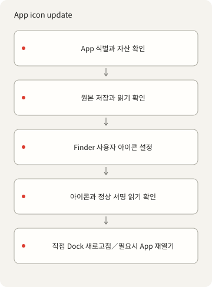
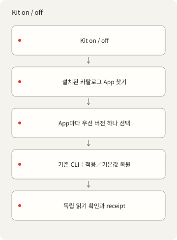

<p></p>

# X-DockIcons

[English](README.md) · [简体中文](README.zh-Hans.md) · [繁體中文](README.zh-Hant.md) ·
[日本語](README.ja.md) · [한국어](README.ko.md) · [Español](README.es.md)

명령줄에서 macOS App과 Dock의 사용자 아이콘을 관리합니다. 자신의 PNG를 등록、적용、복원할 수 있으며,
이 tools-only 소스에는 완성된 아이콘 모음이 없습니다.

## 시작

오프라인 카탈로그 명령에는 Deno 2가 필요합니다. App 검사、PNG→ICNS 패키징、아이콘 작업에는 macOS와
Xcode Command Line Tools가 필요합니다. npm 패키지、계정、AI 서비스、백그라운드 서비스는 필요
없습니다. [의존성](DEPENDENCIES.md)을 확인하세요.

```sh
./dock-icons help
./dock-icons list
./dock-icons check
./dock-icons prompt
```

tools-only 소스는 `{"version":1,"icons":[]}`로 시작합니다. `list`는 빈 목록、`check`는 자산 0개를
검사합니다. 빈 시작 상태의 확인일 뿐 실제 그림 검증은 아닙니다. ID 없는 `prompt`는 텍스트／스타일
설정을 반환하며 이미지 생성이나 AI 호출을 하지 않습니다.

## 사용 권한이 있는 그림 추가

입력은 정사각형 1024–4096px RGBA PNG、실제로 투명한 모서리、최대 15 MiB여야 합니다. 먼저 자산 폴더를
만듭니다. 예제 bundle ID、이름、권리자를 실제 App과 권리 정보로 바꾸세요. 등록 자체는 App 정체성의
권리를 부여하지 않습니다.

```sh
mkdir -p icons/nothing
./dock-icons add my-icon '/path/owned.png' \
  --bundle-id example.myapp --name 'My App' --rights-owner 'Your name'
./dock-icons check
```

`add`는 ICNS 크기 열 개를 패키징／디코딩한 뒤 등록하며 기존 ID／파일을 거부합니다. 입력 원본을
보존하세요. 이후 `check`는 두 파일의 해시와 PNG 크기／알파 규칙을 검사합니다.
[style.json](styles/nothing/style.json)은 Nothing-inspired 색상 참고이며 Atlas 등 기존 모음 이미지는
포함하지 않습니다. 생성과 적용은 각각 별도 권한이 필요합니다.

## App 작업과 복구

자신의 자산을 등록한 후 해당 ID와 의도한 실제 App을 사용하세요. App bundle ID는 카탈로그 항목과
일치해야 합니다. export 출력 경로는 아직 존재하지 않아야 합니다.

```sh
./dock-icons status my-icon --app '/path/My App.app'
./dock-icons apply my-icon --app '/path/My App.app'
./dock-icons restore my-icon --app '/path/My App.app'
./dock-icons default my-icon --app '/path/My App.app'
./dock-icons export my-icon '/path/new-output.png' --app '/path/My App.app'
```



`apply`는 두 자산 해시와 App 정체성을 확인하고 현재 아이콘／Finder 메타데이터를 저장해 다시 읽은 뒤
`NSWorkspace.setIcon`으로 사용자 아이콘 메타데이터를 바꿉니다. 반복은 첫 백업을 유지하고 일치한
이미지는 쓰지 않습니다. `restore`는 이전 사용자 아이콘을 포함한 캡처 기준으로 돌아가며 검증된 백업이
없으면 실패합니다. `default`는 현재 내장 아이콘으로 지우고 이전 사용자 기준을 포함한 백업을
유지합니다. App 업데이트로 내장 아이콘이 달라지면 그 차이를 보고합니다.

상태 잠금으로 직렬 처리하고 prepared／completed／failed 영수증과 별도 프로세스의 렌더링 읽기를
보존합니다. 빈 이미지와 일반 대체 이미지는 거부하고 일반 deep 서명을 전후 비교합니다. 서명된
Contents나 서명 정체성은 바꾸지 않습니다. 보호된 Apple 시스템 App은 검사／export만 가능합니다.
SIP／TCC 우회、재서명、실행 프록시、App 종료、Dock 재시작、 테마 변경은 하지 않습니다. root 소유
폴더에는 별도 설치한 네이티브 관리자 도우미가 필요할 수 있습니다. tools-only 소스에는 포함되지
않으며 `X_DOCKICONS_ADMIN_HELPER`로 지정합니다. 기본값은 없고 누락、인증 취소、정리 실패는 명확한
오류입니다. [의존성](DEPENDENCIES.md)을 확인하세요.

중단 후 먼저 `operations.jsonl`、`backup.json`、App 경로、`status`를 확인하세요. prepared만 있으면
결과는 알 수 없습니다. 사용 중인 잠금은 지우지 마세요. 소유 프로세스 중지를 확인한 뒤에만 오래된
잠금을 제거하고 검증된 백업으로 다시 실행합니다. 실패를 숨기거나 자동 롤백했다고 주장하지 않습니다.
나중에 추가한 Finder 레이블은 보존합니다.

완료는 `verificationScope: "stored-icon-only"`의 증거이며 실제 Dock 표시의 증거는 아닙니다. Dock은
직접 새로고침하고、 타일이 여전히 오래되면 작업을 저장한 뒤 해당 App을 직접 다시 여세요. 반복／이미
기본값인 경우에도 실행 중 대상을 표시합니다. 업데이트／재설치는 사용자 아이콘을 지울 수 있고
Clear／Tinted는 표시를 바꿀 수 있습니다. 시작 시 재적용 서비스나 실제 재부팅 검증을 주장하지
않습니다. 서명된 격리 테스트 App에서 적용과 복원을 확인했으며 설치된 App은 변경하지 않았습니다.

## 선택적 Kit 어댑터

```sh
./dock-icon list
./dock-icon on my-icon --plan
./dock-icon off my-icon --plan
```

포함된 `./dock-icon`은 카탈로그 항목이 하나 이상 필요합니다. 빈 시작 상태에는 선택 가능한
스타일／대상이 없습니다. `fzf`는 터미널 선택용 선택 사항입니다. 시스템 `kit dock-icon`은 외부
설치이며 포함되지 않습니다. `--plan`은 탐색만 하고 아이콘을 쓰지 않습니다. `on`은 설치된 비보호
App마다 우선 변형 하나를 적용하고、 `off`는 현재 내장 기본값으로 돌아가며 백업을 유지합니다.
`restore`는 캡처 기준으로 돌아갑니다. 이미 기본값인 App은 쓰기와 백업 생성을 생략합니다. 같은
스타일／bundle ID의 여러 변형에는 정확히 하나의 `preferred: true`가 필요합니다. 정확한 ID로 변형을
고를 수 있고 고유 퍼지 일치는 대소문자／공백／문장부호를 무시합니다. 모호함과 탐색 오류는 쓰기 전에
멈추며 개별 App 실패는 보고와 0이 아닌 종료에 남습니다. 메뉴 막대 아이콘과 별개이며 macOS
전용입니다.



## 설정、권리、검사

[catalog.json](catalog.json)이 정체성、해시、권리 정보를 관리합니다.
`--catalog /absolute/catalog.json`은 별도 모음을 선택하며 자산 경로는 그 파일 기준입니다.
`--state-dir /absolute/path`는 `~/Library/Application Support/X-DockIcons`를 덮어쓰고 도우미 캐시는
`.local/`에 있습니다. `--app`은 대상 경로 하나를 선택하되 정체성／보호 검사를 유지합니다. 자동
탐색은 표준 Applications 위치를 검사하고 여러 결과를 추측하지 않습니다. 백업、로컬 영수증、개인 App
export는 공개 페이로드에 넣지 마세요.

도구는 로컬 Deno CLI와 작은 AppKit 도우미를 사용합니다. 소유자의 원본 그림、ICNS 기반
미리보기、카탈로그와 이력은 tools-only 소스 밖에 보존합니다.

문서용 마크: [codingEzio](https://github.com/codingEzio) ·
[CC BY 4.0](https://creativecommons.org/licenses/by/4.0/) · [적용 범위](LICENSE-DOC-ARTWORK.md).
코드와 일반 흐름도 12개: [MPL-2.0](LICENSE). 마크 허가는 지정 SVG에만 해당하며 기존
그림、폰트、브랜드、제삼자 권리는 포함하지 않습니다. 자신의 입력에 권리／출처를 기록하세요.
Nothing／Nothing OS는 디자인 영감이며 제휴나 후원이 아닙니다. [크레딧](CREDITS.md).

```sh
deno task check
deno task test
deno task public:test
deno task public:prepare
```

macOS에서 `deno task test`는 네이티브 이미지 검증 도구를 컴파일하므로 Xcode Command Line Tools가
필요합니다. 테스트는 App 아이콘을 변경하지 않습니다.

소스、합성 라우팅／export 경계、로컬 후보를 검사합니다. 자산 0개 검사는 실제 그림 패키징、설치된
아이콘 변경、Dock 표시、재부팅을 검증하지 않습니다. [공개 준비](PUBLICATION.md)는 선택 파일과 제한을
설명합니다. 이 명령은 공개、업로드、 remote 생성、보존한 비공개 이력 재작성을 하지 않습니다.

같은 catalog에 동시 추가하면 잠금 중인 요청은 거부됩니다. 중단 후 잠금과 미완료 파일을 확인하고 사용
중인 잠금은 삭제하지 마세요. export는 기존 파일을 덮어쓰지 않습니다.
