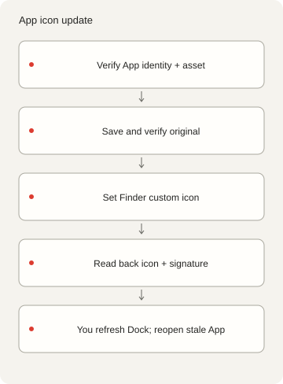
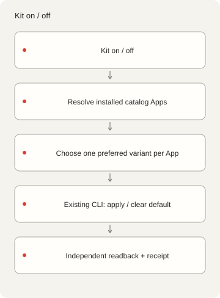

<p></p>

# X-DockIcons

[English](README.md) · [简体中文](README.zh-Hans.md) · [繁體中文](README.zh-Hant.md) ·
[日本語](README.ja.md) · [한국어](README.ko.md) · [Español](README.es.md)

Manage custom macOS App and Dock icons from the command line. Bring your own PNG to register, apply
and restore icons; this tools-only source includes no ready-made collection.

## Start

Deno 2 runs the offline catalog commands. App inspection, PNG-to-ICNS packaging and icon operations
require macOS and Xcode Command Line Tools. No npm package, account, AI service or background
service is required. See [dependencies](DEPENDENCIES.md).

```sh
./dock-icons help
./dock-icons list
./dock-icons check
./dock-icons prompt
```

The tools-only source starts with `{"version":1,"icons":[]}`: `list` returns an empty list and
`check` verifies zero assets. That result checks the empty starter, not any real artwork. `prompt`
without an ID returns text/style settings; it does not generate an image or call an AI provider.

## Add artwork you may use

Supply a square 1024–4096px RGBA PNG with real transparent corners, at most 15 MiB. Create the asset
directory first. Replace the sample bundle ID, name and rights owner with the intended App and your
actual rights information; registering an image does not grant rights to its underlying identity.

```sh
mkdir -p icons/nothing
./dock-icons add my-icon '/path/owned.png' \
  --bundle-id example.myapp --name 'My App' --rights-owner 'Your name'
./dock-icons check
```

`add` packages and decodes ten ICNS sizes before adding the manifest entry. Existing IDs/files are
refused. Keep your input original. `check` then verifies both hashes and the PNG shape/alpha rules.
The palette in [style.json](styles/nothing/style.json) is a Nothing-inspired reference; no Atlas or
other original collection image is bundled. Generation and application need their own authority.

## App operations and recovery

After registering your own asset, use its ID and the intended real App. The example App must have
the same bundle ID as the catalog entry. Export requires a new output path.

```sh
./dock-icons status my-icon --app '/path/My App.app'
./dock-icons apply my-icon --app '/path/My App.app'
./dock-icons restore my-icon --app '/path/My App.app'
./dock-icons default my-icon --app '/path/My App.app'
./dock-icons export my-icon '/path/new-output.png' --app '/path/My App.app'
```



`apply` validates both asset hashes and App identity, then saves and reads back the current icon and
Finder metadata before changing custom-icon metadata through `NSWorkspace.setIcon`. Repeating it
retains the first backup and skips a matching image. `restore` returns that captured baseline,
including an earlier custom icon; it fails if no verified backup exists. `default` clears to the
current built-in icon while retaining the backup. It does not replace a prior custom baseline.
Updates can change the built-in icon; that difference is reported.

Operations serialize with a state lock and record prepared/completed/failed receipts plus separate
rendered readback. Nearly blank or generic fallback images are rejected. Ordinary deep signatures
are compared before/after; signed App Contents and signing identities are not changed. Protected
Apple system Apps are inspection/export only. No SIP/TCC bypass, re-signing, launcher proxy, App
quit, Dock restart or theme change is included. Root-owned metadata writes can need a separately
installed administrator helper. In the tools-only source, configure `X_DOCKICONS_ADMIN_HELPER`;
there is no default. It is not bundled, and missing helpers/cancellation/cleanup errors fail
visibly. See [dependencies](DEPENDENCIES.md).

For an interruption, inspect `operations.jsonl`, `backup.json`, App path and `status` first. A
prepared-only receipt means the outcome is unknown. Do not remove an active lock; remove a lock only
after confirming its owner has stopped, then reuse the verified backup. Failures are not hidden or
claimed automatically rolled back. Later Finder labels are preserved.

Completed operations prove `verificationScope: "stored-icon-only"`, not live Dock appearance.
Refresh Dock yourself; if a tile stays stale, save your work and reopen that App yourself. Running
targets are listed, including repeat/already-default paths. Updates/reinstalls may remove custom
icons; Clear/Tinted appearance may change their display. No startup reapply job or physical reboot
acceptance is claimed. A signed, isolated test App was used to verify apply and restore; no
installed App was changed.

## Optional Kit adapter

```sh
./dock-icon list
./dock-icon on my-icon --plan
./dock-icon off my-icon --plan
```

The included `./dock-icon` adapter needs at least one catalog item; an empty starter has no
selectable style/target. Optional `fzf` provides terminal selection. A system `kit dock-icon`
installation is external and is not bundled. `--plan` performs discovery without icon writes. `on`
applies one preferred variant per installed nonprotected App; `off` uses current built-in defaults
and preserves backups. `restore` still returns the captured baseline. Already-default Apps skip
writes and backup creation. Exact IDs select variants; multiple variants of one style/bundle ID
require exactly one `preferred: true`. Unique fuzzy matches ignore case, spaces and punctuation;
ambiguity or discovery errors stop before writes. Per-App failures remain visible and return
nonzero. App icons are separate from menu-bar icons; these operations are macOS-only.



## Configuration, rights and checks

[catalog.json](catalog.json) owns identities, checksums and rights notes.
`--catalog /absolute/catalog.json` selects a separate collection with assets relative to that file.
`--state-dir /absolute/path` overrides `~/Library/Application Support/X-DockIcons`; helper caches
live in `.local/`. `--app` selects one intended path and still checks identity/protection. Automatic
discovery checks standard Applications locations and rejects multiple matches instead of guessing.
Keep backups, local receipts and personal App exports outside the public payload.

The tools use a local Deno CLI and a small AppKit helper. The private owner's original artwork,
ICNS-derived previews, catalog and history remain preserved outside this tools-only source.

Documentation mark: [codingEzio](https://github.com/codingEzio) ·
[CC BY 4.0](https://creativecommons.org/licenses/by/4.0/) · [Scope](LICENSE-DOC-ARTWORK.md). Code
and the 12 generic workflow diagrams: [MPL-2.0](LICENSE). The mark grant covers only its named SVG;
no old artwork, font, brand or third-party identity grant is included. Supply rights/provenance for
your own inputs. Nothing / Nothing OS is design inspiration, without affiliation or endorsement. See
[credits](CREDITS.md).

```sh
deno task check
deno task test
deno task public:test
deno task public:prepare
```

On macOS, `deno task test` compiles the native image validator and requires Xcode Command Line
Tools; tests do not change App icons.

These commands check source, synthetic routing/export boundaries and a local candidate. Empty-asset
checks do not prove real-art packaging, installed icon changes, Dock appearance or reboot behavior.
[Publication preparation](PUBLICATION.md) describes the selected files and their limits. The
commands do not publish, upload, create a remote or rewrite the preserved private history.

Concurrent adds to one catalog are refused while it is locked. After interruption, inspect the lock
and any incomplete assets before recovery; do not delete an active lock. Export never replaces an
existing output.
