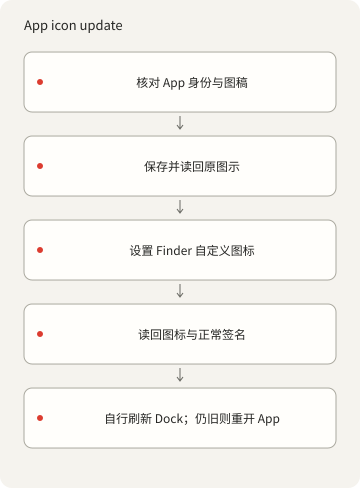
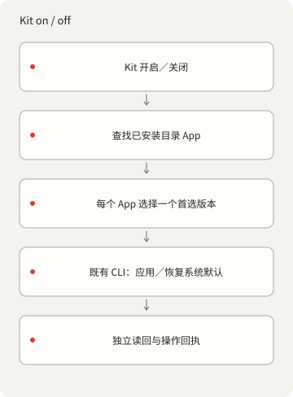

<p></p>

# X-DockIcons

[English](README.md) · [简体中文](README.zh-Hans.md) · [繁體中文](README.zh-Hant.md) ·
[日本語](README.ja.md) · [한국어](README.ko.md) · [Español](README.es.md)

从命令行管理 macOS App 与 Dock 自定义图标。使用自己的 PNG 登记、应用及还原图标；此 tools-only
源码不附带现成图标集。

## 开始

离线图库命令需要 Deno 2。检查 App、PNG 转 ICNS 和图标操作需要 macOS 与 Xcode Command Line Tools。
不需要 npm 包、账号、AI 服务或后台服务。详见[依赖](DEPENDENCIES.md)。

```sh
./dock-icons help
./dock-icons list
./dock-icons check
./dock-icons prompt
```

tools-only 源码以 `{"version":1,"icons":[]}` 开始：`list` 返回空列表，`check` 验证零个资源。
这只验证空白起点，不代表真实图稿通过检查。无 ID 的 `prompt` 返回文字／样式设置，不会生成图片或调用
AI。

## 加入你有权使用的图稿

输入须为正方形 1024–4096px RGBA PNG，有真正透明的四角，最大 15 MiB。先建立资源目录。 将示例 bundle
ID、名称和权利人换成目标 App 与实际权利信息；登记图片不会授予底层 App 身份的权利。

```sh
mkdir -p icons/nothing
./dock-icons add my-icon '/path/owned.png' \
  --bundle-id example.myapp --name 'My App' --rights-owner 'Your name'
./dock-icons check
```

`add` 在登记前打包并解码十种 ICNS 尺寸，拒绝已有 ID／文件。请保留输入原件。之后的 `check`
验证两份文件的哈希及 PNG 尺寸／透明通道规则。[style.json](styles/nothing/style.json) 提供
Nothing-inspired 配色参考，不附带 Atlas 或其他旧图库图像。生成与应用各自需要授权。

## App 操作与恢复

登记自己的资源后，使用它的 ID 和真实目标 App。示例 App 的 bundle ID 必须与图库记录一致。
导出必须指定尚不存在的输出路径。

```sh
./dock-icons status my-icon --app '/path/My App.app'
./dock-icons apply my-icon --app '/path/My App.app'
./dock-icons restore my-icon --app '/path/My App.app'
./dock-icons default my-icon --app '/path/My App.app'
./dock-icons export my-icon '/path/new-output.png' --app '/path/My App.app'
```



`apply` 验证两份资源哈希与 App 身份，先保存并读回当前图标及 Finder 元数据，再通过
`NSWorkspace.setIcon` 修改自定义图标元数据。重复操作保留首次备份，并跳过已匹配的图像。 `restore`
返回已捕获的基线，包括原有自定义图标；无有效备份则失败。`default` 清除到当前内建图标，
同时保留备份，不会把之前的自定义基线换掉。App 更新可能改变内建图标，这种差异会明确报告。

状态锁串行执行操作，并保留 prepared／completed／failed
收据及独立渲染读回。空白和通用占位图像会被拒绝。 操作前后比较普通 deep 签名；不改已签名 Contents
或签名身份。受保护 Apple 系统 App 仅允许检查／导出。 不绕过 SIP／TCC、不重签、不加启动代理、不退出
App、不重启 Dock、不改主题。root 所有的目录可能需要另行安装的 原生管理员辅助程序；tools-only
源码须以 `X_DOCKICONS_ADMIN_HELPER`
指定它，没有默认值；缺失、取消授权或清理失败均明确报错。详见[依赖](DEPENDENCIES.md)。

中断后先检查 `operations.jsonl`、`backup.json`、App 路径和 `status`。只有 prepared
收据表示结果未知。
不能删除仍在使用的锁；确认所属进程停止后才可移除旧锁，再沿用有效备份重跑。失败不会被隐藏或声称自动回滚。
后来的 Finder 标签会保留。

完成仅证明 `verificationScope: "stored-icon-only"`，不证明实时 Dock 外观。请自行刷新 Dock；若仍旧，
先保存工作再自行重开
App。重复／已默认路径也会列出运行目标。更新／重装可能移除自定义图标，Clear／Tinted
可能改变显示效果。没有启动重套用服务，也不声称实机重启验收。已用隔离的签名测试 App
验证套用与恢复；未更改已安装的 App。

## 可选 Kit 适配器

```sh
./dock-icon list
./dock-icon on my-icon --plan
./dock-icon off my-icon --plan
```

随附的 `./dock-icon` 至少需要一个图库项目；空白起点没有可选样式／目标。`fzf` 可选，用于终端选择。
系统级 `kit dock-icon` 是外部安装，不包含在 tools-only 源码中。`--plan` 只发现目标，不写图标。 `on`
对已安装且非保护 App 各应用一个首选版本；`off` 返回当前内建默认并保留备份，`restore`
仍返回捕获基线。 已默认的 App 跳过写入和备份建立。同样式／bundle ID 的多个版本必须恰有一个
`preferred: true`，精确 ID 可选版本。
唯一模糊匹配忽略大小写、空格、标点；歧义或发现错误在写入前停止。单项失败保留在报告并以非零退出。 App
图标与菜单栏图标不同；这些操作仅限 macOS。



## 设置、权利与检查

[catalog.json](catalog.json) 管理身份、哈希与权利信息。`--catalog /absolute/catalog.json`
选择独立图库， 资源相对此文件定位。`--state-dir /absolute/path` 覆盖
`~/Library/Application Support/X-DockIcons`； 辅助程序缓存在 `.local/`。`--app`
选择单一目标路径，仍检查身份与保护规则。自动发现检查标准 Applications 位置，
多份匹配则拒绝猜测。备份、本地收据与个人 App 导出不得放进公开载荷。

工具使用本地 Deno CLI 与小型 AppKit 辅助程序。私人原始图稿、ICNS 衍生预览、图库与历史均保留在
tools-only 源码之外。

文档标记：[codingEzio](https://github.com/codingEzio) ·
[CC BY 4.0](https://creativecommons.org/licenses/by/4.0/) · [授权范围](LICENSE-DOC-ARTWORK.md)。
代码与 12 份通用流程图：[MPL-2.0](LICENSE)。标记授权仅限指定
SVG，不包含旧图稿、字体、品牌或第三方身份授权。 自己的输入须有权利／来源记录。Nothing／Nothing OS
仅为设计灵感，不代表关联或背书。详见[鸣谢](CREDITS.md)。

```sh
deno task check
deno task test
deno task public:test
deno task public:prepare
```

在 macOS 上，`deno task test` 会编译原生图片验证工具，需要 Xcode 命令行工具；测试不会更改 App 图标。

这些命令检查源码、合成路由／导出边界及本地候选。零资源检查不证明真实图稿打包、已安装图标变更、Dock
外观或重启行为。 [发布准备](PUBLICATION.md) 说明选定文件及其限制；这些命令不会发布、上传、建立
remote 或改写保留的私人历史。

同一 catalog
同时新增时，锁定中的其他新增会被拒绝。中断后请先检查锁与未完成资源，勿删除使用中的锁。导出不覆盖已有文件。

### 本机图集配置

可选的 `Local/config.json` 不纳入 Git。`catalog`、`style`、`adminHelper`
填写路径；相对路径以配置文件目录为准。`X_DOCKICONS_CONFIG`
指定绝对配置路径，指定后文件不存在即报错。无配置时使用附带的空图集和风格。`--catalog`
覆盖配置图集，`X_DOCKICONS_ADMIN_HELPER` 覆盖配置的
helper。选定文件缺失或配置无效时会报错；私人图像、图集、备份和 helper 路径须留在 Git 之外。
