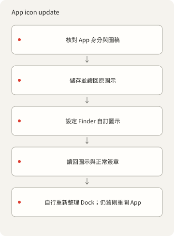
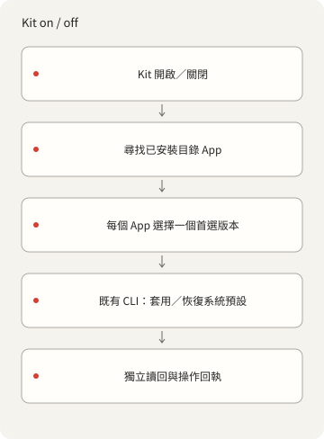

<p></p>

# X-DockIcons

[English](README.md) · [简体中文](README.zh-Hans.md) · [繁體中文](README.zh-Hant.md) ·
[日本語](README.ja.md) · [한국어](README.ko.md) · [Español](README.es.md)

從命令列管理 macOS App 與 Dock 自訂圖示。使用自己的 PNG 登記、套用及還原圖示；此 tools-only
原始碼不附帶現成圖示集。

## 開始

離線圖庫命令需要 Deno 2。檢查 App、PNG 轉 ICNS 與圖示操作需要 macOS 及 Xcode Command Line Tools。
不需要 npm 套件、帳號、AI 服務或背景服務。詳見[依賴](DEPENDENCIES.md)。

```sh
./dock-icons help
./dock-icons list
./dock-icons check
./dock-icons prompt
```

tools-only 原始碼以 `{"version":1,"icons":[]}` 開始：`list` 回傳空列表，`check` 驗證零個資源。
這只驗證空白起點，不代表真實圖稿通過檢查。無 ID 的 `prompt` 回傳文字／樣式設定，不會生成圖片或呼叫
AI。

## 加入你有權使用的圖稿

輸入須為正方形 1024–4096px RGBA PNG，有真正透明的四角，最大 15 MiB。先建立資源目錄。 將範例 bundle
ID、名稱與權利人換成目標 App 及實際權利資訊；登記圖片不會授予底層 App 身分的權利。

```sh
mkdir -p icons/nothing
./dock-icons add my-icon '/path/owned.png' \
  --bundle-id example.myapp --name 'My App' --rights-owner 'Your name'
./dock-icons check
```

`add` 在登記前封裝並解碼十種 ICNS 尺寸，拒絕已有 ID／檔案。請保留輸入原件。之後的 `check`
驗證兩份檔案的雜湊及 PNG 尺寸／透明通道規則。[style.json](styles/nothing/style.json) 提供
Nothing-inspired 配色參考，不附帶 Atlas 或其他舊圖庫影像。生成與套用各自需要授權。

## App 操作與復原

登記自己的資源後，使用它的 ID 與真實目標 App。範例 App 的 bundle ID 必須與圖庫紀錄一致。
匯出必須指定尚不存在的輸出路徑。

```sh
./dock-icons status my-icon --app '/path/My App.app'
./dock-icons apply my-icon --app '/path/My App.app'
./dock-icons restore my-icon --app '/path/My App.app'
./dock-icons default my-icon --app '/path/My App.app'
./dock-icons export my-icon '/path/new-output.png' --app '/path/My App.app'
```



`apply` 驗證兩份資源雜湊與 App 身分，先儲存並讀回目前圖示及 Finder 中繼資料，再透過
`NSWorkspace.setIcon` 修改自訂圖示中繼資料。重複操作保留首次備份，並跳過已匹配的影像。 `restore`
返回已擷取的基線，包括原有自訂圖示；無有效備份則失敗。`default` 清除到目前內建圖示，
同時保留備份，不會把之前的自訂基線換掉。App 更新可能改變內建圖示，這種差異會明確回報。

狀態鎖循序執行操作，並保留 prepared／completed／failed
收據及獨立算圖讀回。空白與通用佔位影像會被拒絕。 操作前後比較普通 deep 簽章；不改已簽章 Contents
或簽章身分。受保護 Apple 系統 App 僅允許檢查／匯出。 不繞過 SIP／TCC、不重簽、不加啟動代理、不退出
App、不重啟 Dock、不改主題。root 所有的目錄可能需要另行安裝的 原生管理員輔助程式；tools-only
原始碼須以 `X_DOCKICONS_ADMIN_HELPER`
指定它，沒有預設值；缺失、取消授權或清理失敗均明確報錯。詳見[依賴](DEPENDENCIES.md)。

中斷後先檢查 `operations.jsonl`、`backup.json`、App 路徑及 `status`。只有 prepared
收據表示結果未知。
不能刪除仍在使用的鎖；確認所屬程序停止後才可移除舊鎖，再沿用有效備份重跑。失敗不會被隱藏或聲稱自動復原。
後來的 Finder 標籤會保留。

完成僅證明 `verificationScope: "stored-icon-only"`，不證明即時 Dock 外觀。請自行重新整理
Dock；若仍舊， 先儲存工作再自行重開
App。重複／已預設路徑也會列出執行中目標。更新／重裝可能移除自訂圖示，Clear／Tinted
可能改變顯示效果。沒有啟動重套用服務，也不聲稱實機重啟驗收。已用隔離的簽名測試 App
驗證套用與還原；未更改已安裝的 App。

## 選用 Kit 介接程式

```sh
./dock-icon list
./dock-icon on my-icon --plan
./dock-icon off my-icon --plan
```

隨附的 `./dock-icon` 至少需要一個圖庫項目；空白起點沒有可選樣式／目標。`fzf` 為選用，供終端機選擇。
系統級 `kit dock-icon` 是外部安裝，不包含在 tools-only 原始碼中。`--plan` 只尋找目標，不寫圖示。
`on` 對已安裝且非保護 App 各套用一個偏好版本；`off` 返回目前內建預設並保留備份，`restore`
仍返回擷取基線。 已預設的 App 跳過寫入及備份建立。同樣式／bundle ID 的多個版本必須恰有一個
`preferred: true`，精確 ID 可選版本。
唯一模糊匹配忽略大小寫、空白、標點；歧義或尋找錯誤在寫入前停止。單項失敗保留在報告並以非零退出。 App
圖示與選單列圖示不同；這些操作僅限 macOS。



## 設定、權利與檢查

[catalog.json](catalog.json) 管理身分、雜湊與權利資訊。`--catalog /absolute/catalog.json`
選擇獨立圖庫， 資源相對此檔案定位。`--state-dir /absolute/path` 覆寫
`~/Library/Application Support/X-DockIcons`； 輔助程式快取在 `.local/`。`--app`
選擇單一目標路徑，仍檢查身分與保護規則。自動尋找檢查標準 Applications 位置，
多份匹配則拒絕猜測。備份、本機收據與個人 App 匯出不得放進公開載荷。

工具使用本機 Deno CLI 與小型 AppKit 輔助程式。私人原始圖稿、ICNS 衍生預覽、圖庫與歷史均保留在
tools-only 原始碼之外。

文件標記：[codingEzio](https://github.com/codingEzio) ·
[CC BY 4.0](https://creativecommons.org/licenses/by/4.0/) · [授權範圍](LICENSE-DOC-ARTWORK.md)。
程式碼與 12 份通用流程圖：[MPL-2.0](LICENSE)。標記授權僅限指定
SVG，不包含舊圖稿、字型、品牌或第三方身分授權。 自己的輸入須有權利／來源紀錄。Nothing／Nothing OS
僅為設計靈感，不代表關聯或背書。詳見[致謝](CREDITS.md)。

```sh
deno task check
deno task test
deno task public:test
deno task public:prepare
```

在 macOS 上，`deno task test` 會編譯原生圖片驗證工具，需要 Xcode 命令列工具；測試不會更改 App 圖示。

這些命令檢查原始碼、合成路由／匯出邊界及本機候選。零資源檢查不證明真實圖稿封裝、已安裝圖示變更、Dock
外觀或重啟行為。 [發布準備](PUBLICATION.md) 說明選定檔案及其限制；這些命令不會發布、上傳、建立
remote 或改寫保留的私人歷史。

同一 catalog
同時新增時，鎖定中的其他新增會被拒絕。中斷後請先檢查鎖與未完成資源，勿刪除使用中的鎖。匯出不覆寫既有檔案。

### 本機圖集設定

選用的 `Local/config.json` 不納入 Git。`catalog`、`style`、`adminHelper`
填入路徑；相對路徑以設定檔目錄為準。`X_DOCKICONS_CONFIG`
指定絕對設定路徑，指定後檔案不存在即報錯。無設定時使用附帶的空圖集和風格。`--catalog`
覆蓋設定的圖集，`X_DOCKICONS_ADMIN_HELPER` 覆蓋設定的
helper。選定檔案缺失或設定無效時會報錯；私人圖像、圖集、備份和 helper 路徑須留在 Git 之外。
